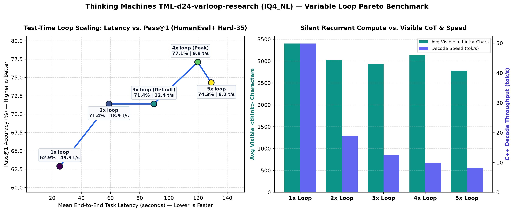

# Test-Time Recurrent Loop Scaling in `TML-d24-varloop-research`

An empirical systems and reasoning Pareto benchmark of Thinking Machines Lab's variable-loop recurrent Mixture-of-Experts checkpoint (**`TML-d24-varloop-research`**, `IQ4_NL` 4-bit GGUF) across `loop_num_passes = [1, 2, 3, 4, 5]` on the **35 hardest HumanEval+ problems (by canonical-solution length)**.

> **About the model:** `TML-d24-varloop-research` is **not Inkling 2 Mini**. It is the variable-loop research sibling that Thinking Machines released alongside Inkling 2 Mini *"so others can run their own experiments."* Per the [model card](https://huggingface.co/thinkingmachines/TML-d24-varloop-research), it *"shares its pretraining and first stage of midtraining with Inkling 2 Mini"*. It is a 24-layer MoE (128 experts, 8 active) whose middle 12 layers loop a configurable number of times. It was trained with 1–5 passes and post-trained with 3, which is the range swept here. Thinking Machines *"caution against comparing TML-d24-varloop-research directly to Inkling 2 Mini,"* so none of the numbers below should be read as Inkling 2 Mini results.



---

## Key Findings

1. **4x Loops Gave the Highest Pass@1 (+14.2 pp over 1x):** Scaling silent recurrent passes from `1x` to `4x` lifts Pass@1 from **62.9% → 77.1%** with zero weight changes and a near-constant VRAM footprint (~18.0–18.5 GiB across both GPUs).
2. **2x Loops Is the Latency-Efficiency Sweet Spot:** `2x` passes reach **71.4% Pass@1**, the same as the model's `3x` default, while delivering **1.52× higher decode throughput** (`18.9` vs. `12.4` tok/s) and **34% lower end-to-end latency** (`58.9s` vs. `89.7s`).
3. **Silent Recurrence Generally Compresses Visible Chain-of-Thought:** From `1x` to `5x`, visible `<think>` length drops **18.3%** (`3,404` → `2,782` chars) and total output tokens drop **13.9%** (`1,190` → `1,025`). The trend is not strictly monotonic (`3404 → 3027 → 2932 → 3134 → 2782`, with a bump at `4x`), but it suggests latent recurrent depth partly substitutes for token-space trial-and-error.
4. **Explicit MoE Expert Placement Gives a 5.4× Decode Speedup on Dual T4s:** Pinning the fused expert tensors of layers 12–23 to the second GPU took decode from **2.5 → 13.6 tok/s** (at `3x` loops) compared with a naive partial-offload layer split. See [Systems Engineering](#systems-engineering-dual-t4-moe-tensor-placement-in-llamacpp).

> **Caveats:** single seed, `N = 35` tasks, `temperature=1.0`, one sample per task. One task is worth **2.86 pp**, so the `4x` result (77.1%) is **two more solved tasks** than `2x`/`3x` (71.4%). Treat the accuracy ordering as suggestive rather than statistically significant. Multi-seed runs are the obvious next step.

---

## Benchmark Results (HumanEval+ Hard-35)

Evaluated on the 35 longest canonical-solution problems in `evalplus/humanevalplus` (`temperature=1.0`, `reasoning_effort="medium"`, `max_tokens=2048`, single sample) on 2× NVIDIA Tesla T4 GPUs:

| Loop Passes | Tasks | Pass@1 (%) | Decode Speed (tok/s) | Mean Latency (s) | Mean Output Tokens | Mean `<think>` Chars | Dual-T4 VRAM (GiB) |
| :---: | :---: | :---: | :---: | :---: | :---: | :---: | :---: |
| **1x** | 35 | 62.9% | 49.9 | 25.2 | 1,190 | 3,404 | 17.96 |
| **2x** | 35 | 71.4% | 18.9 | 58.9 | 1,079 | 3,027 | 18.47 |
| **3x (Default)** | 35 | 71.4% | 12.4 | 89.7 | 1,071 | 2,932 | 17.96 |
| **4x (Peak)** | 35 | **77.1%** | 9.9 | 119.7 | 1,137 | 3,134 | 18.15 |
| **5x** | 35 | 74.3% | 8.2 | 129.0 | 1,025 | 2,782 | 18.34 |

Raw summary data: [`results/varloop_35_summary.csv`](results/varloop_35_summary.csv). The full executed run, with its original outputs, is in [`notebooks/tml_varloop_kaggle_benchmark.ipynb`](notebooks/tml_varloop_kaggle_benchmark.ipynb).

**Possible token-budget truncation:** several failing runs logged 6,200–6,800+ `<think>` characters (roughly 1,550–1,700+ tokens), which leaves little room for the final code under the 2,048-token cap. Some failures, particularly at `1x`, may be truncations rather than wrong solutions. If so, part of the gain from extra loops could come from the model finishing within budget. This has not been verified per task, because the per-task CSV was not preserved.

---

## Systems Engineering: Dual-T4 MoE Tensor Placement in `llama.cpp`

`TML-d24-varloop-research-IQ4_NL.gguf` (17.6 GB) packs 128 MoE experts into fused 3D tensors (`ffn_gate_exps`, `ffn_up_exps`, `ffn_down_exps`). On dual 15 GB Tesla T4s, a full-offload `--split-mode layer` run failed on `CUDA0` during the original session (`allocating 15861.32 MiB on device 0: cudaMalloc failed: out of memory`, against ~14.8 GB free), and `--split-mode row` does not support the 3D expert buffers.

| Configuration (3x loops) | GPU 0 | GPU 1 | Decode |
| :--- | ---: | ---: | ---: |
| `-ngl 22 --tensor-split 0.45,0.55` (partial offload) | 8,103 MiB | 995 MiB | **2.5 tok/s** |
| `-ngl 99 --tensor-split 1,1 -ot "blk\.(1[2-9]\|2[0-3])\.ffn_.*_exps=CUDA1"` | 8,695 MiB | 9,697 MiB | **13.6 tok/s** |

Routing the expert tensors of layers `12–23` to `CUDA1` via `--override-tensor` (`-ot`) balances memory across both GPUs (~8.5 GiB + ~9.5 GiB) with every layer on the GPU:

```bash
./llama-server \
  -m TML-d24-varloop-research-IQ4_NL.gguf \
  --override-kv inkling2_loop.loop.count=int:4 \
  --fit off \
  -ngl 99 \
  --split-mode layer \
  --tensor-split 1,1 \
  -ot "blk\.(1[2-9]|2[0-3])\.ffn_.*_exps=CUDA1" \
  -c 4096 \
  --jinja --temp 1.0 --port 8080
```

### Kaggle / Tesla T4 Setup Notes

- **Use the CUDA 12.x `llama.cpp` build, not CUDA 13.x.** The CUDA 13.5 build (`b12631`) aborts on T4 with `CUDA error: the provided PTX was compiled with an unsupported toolchain`. The CUDA 12.8 build (`b12633`) works.
- **Put the CUDA runtime libraries next to `llama-server`.** The `cudart-*.tar.gz` bundle extracts to a separate folder. Copy `libcudart.so.12`, `libcublas.so.12` and `libcublasLt.so.12` into the binary's directory (and set `LD_LIBRARY_PATH` to it). Otherwise `ggml-cuda` fails to load and the server silently falls back to CPU (~5 tok/s). Check with `llama-server --list-devices`, which should show both `CUDA0` and `CUDA1`.
- **Disk space is tight.** With the 17.6 GB model, Kaggle's 21 GB `/kaggle/working` had ~1.4 GB free. Delete the `.tar.gz` archives after extracting them.

---

## Quickstart & Reproduction

```bash
pip install -r requirements.txt

# 1. Run the 5-loop sweep across the 35 hardest HumanEval+ problems
python benchmark.py \
  --model /path/to/TML-d24-varloop-research-IQ4_NL.gguf \
  --server-bin /path/to/llama-server \
  --tasks 35 \
  --out-dir results

# 2. Regenerate the Pareto frontier plot
python plot_pareto.py --summary results/varloop_35_summary.csv --out assets/inkling2_varloop_pareto_35.png
```

## Repository Layout

```text
├── benchmark.py          # llama-server sweep harness (1x–5x loops, HumanEval+ Hard-35)
├── plot_pareto.py        # Dual-panel Pareto + CoT-compression chart
├── requirements.txt
├── notebooks/
│   └── tml_varloop_kaggle_benchmark.ipynb   # Cleaned Kaggle run with original outputs
├── assets/
│   └── inkling2_varloop_pareto_35.png
└── results/
    └── varloop_35_summary.csv
```
